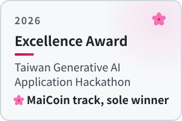
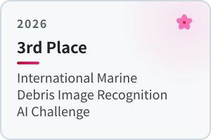
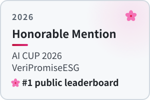
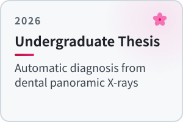
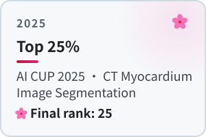
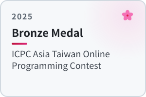

  
  
  

### Education

**National Taiwan Normal University** — B.S. in Computer Science and Information Engineering, 2023 – 2027 (expected)

### Publications

 
<b><i>TEAM_10049 at the NTCIR-19 AI CUP VeriPromise ESG Track: What a Field Is Really Worth under a Gated, Rare-Class Metric</i></b> 
Ya-You Shih, <ins>Yi-Hsin Wang</ins>, Chia-Hui Chang 
<a href="https://github.com/Eason20050201/Portfolio/blob/main/papers/Shih_2026_NTCIR19_VeriPromiseESG.pdf">PDF</a> · <a href="https://github.com/yayayouyou/ai_cup_GreenReport_Yayou_Eason">Code</a>

 
<b><i>Next-Stroke Prediction in Table Tennis with Test-Time Player Profiling for Training-Unseen Players</i></b> 
<ins>Yi-Hsin Wang</ins>, Ya-You Shih 
<a href="https://github.com/Eason20050201/Portfolio/blob/main/papers/Wang_2026_TAAI_NextStrokePrediction.pdf">PDF</a> · <a href="https://github.com/Eason20050201/ttpp-table-tennis">Code</a>

### Highlights

  <a href="https://github.com/yayayouyou/Hackathon_MaiCoin_chmod777"><picture><source media="(prefers-color-scheme: dark)" srcset="assets/sakura/card-hackathon-dark.svg"></picture></a>
  <picture><source media="(prefers-color-scheme: dark)" srcset="assets/sakura/card-marine-dark.svg"></picture>
  <a href="https://github.com/yayayouyou/ai_cup_GreenReport_Yayou_Eason"><picture><source media="(prefers-color-scheme: dark)" srcset="assets/sakura/card-esg-dark.svg"></picture></a>

  <a href="https://github.com/Eason20050201/pano-dental-detect"><picture><source media="(prefers-color-scheme: dark)" srcset="assets/sakura/card-thesis-dark.svg"></picture></a>
  <a href="https://github.com/yayayouyou/aicontest_HeartMuscle_1"><picture><source media="(prefers-color-scheme: dark)" srcset="assets/sakura/card-cardiac-dark.svg"></picture></a>
  <picture><source media="(prefers-color-scheme: dark)" srcset="assets/sakura/card-icpc-dark.svg"></picture>

### Tools

  

